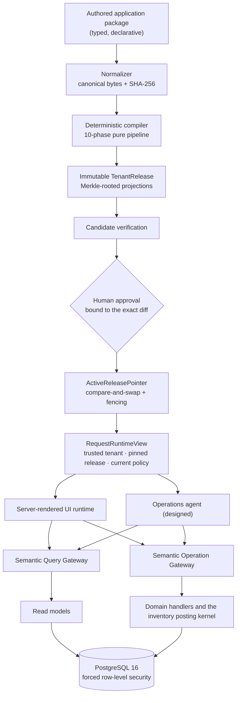

# North Star ERP

**An ERP for businesses that hold stock. The whole application is compiled from one
versioned definition, and every change ships as a verified, approved and reversible
release.**

North Star runs the operating loop of a stock-holding business: buy, receive, know
exactly what is on hand and what is free to sell, sell, reserve, and ship. Structurally
it is a **compiler and a release kernel**. Records, fields, relations, lifecycles,
queries, operations, permissions, screens and AI-agent tool descriptions are all
written in one typed application language. A deterministic compiler turns that
definition into an immutable, content-addressed release, and the runtime serves exactly
one approved release per tenant.

That design is aimed at the two capabilities the product is built toward:

- **Customization without forks.** A tenant's change produces a new release that goes
  through the same compiler, verification, approval and rollback path as first-party
  code. There is no overlay layer to drift from the base product.
- **An AI operations agent with no privileged back door.** The agent sees only what the
  compiler projects for it. It acts only through the same gateways, permission checks
  and audit trail as a human user.

---

## At a glance

|                     |                                                                                                                                                                 |
| ------------------- | --------------------------------------------------------------------------------------------------------------------------------------------------------------- |
| **Stage**           | Pre-launch. The purchase → receive → stock → sell → reserve → ship loop runs end to end on PostgreSQL. There is no production tenant yet                        |
| **Built on `main`** | 6 modules, 25 entities, 135 fields, 99 queries, 93 operations, 70 screens, 116 permissions, 4 registered domain capabilities                                    |
| **Code**            | ≈92,000 lines of production TypeScript · ≈131,000 lines of tests · 6,781 lines of SQL in 28 append-only migrations                                              |
| **Verification**    | 1,077 automated tests in 11 suites, all green in CI on `main`'s tree (2026-10-22) · 139 mutation controls · 2,050 language-coverage obligations                 |
| **Decisions**       | 66 accepted Architecture Decision Records in [`docs/decisions/`](docs/decisions)                                                                                |
| **Stack**           | TypeScript 5.9 on Node 22.22.2 · PostgreSQL 16.14 (image pinned by digest) · Zod 4.1.12 · pnpm 11.9 monorepo · Playwright · no UI framework                     |
| **Not built yet**   | The AI agent runtime, the tenant customization engine, production sign-in, and the background worker. Their contracts are designed and partly projected already |

---

## Contents

1. [The product](#1-the-product)
2. [Architecture](#2-architecture)
3. [The application language](#3-the-application-language)
4. [The compiler](#4-the-compiler)
5. [The release kernel](#5-the-release-kernel)
6. [Semantic gateways](#6-semantic-gateways)
7. [Storage, tenancy and security](#7-storage-tenancy-and-security)
8. [The inventory posting kernel](#8-the-inventory-posting-kernel)
9. [Audit, lifecycle and recovery](#9-audit-lifecycle-and-recovery)
10. [The UI runtime](#10-the-ui-runtime)
11. [The AI operations agent (designed)](#11-the-ai-operations-agent-designed)
12. [The customization engine (designed)](#12-the-customization-engine-designed)
13. [Engineering assurance](#13-engineering-assurance)
14. [Current state](#14-current-state)
15. [Roadmap](#15-roadmap)
16. [Repository layout](#16-repository-layout)
17. [Running it locally](#17-running-it-locally)
18. [Further reading](#18-further-reading)

---

## 1. The product

### The operating loop

```text
Supplier ─► Purchase order ─► Goods receipt ─► posted inventory movements (+)
                                                         │
                      on hand · reserved · available  (derived, never typed in)
                                                         │
Customer ─► Sales order ─► Reservation ─► Shipment ─► posted inventory movements (−)
```

Stock levels are not editable numbers. They are **sums over an append-only ledger of
posted movements**, kept in sync with a projection that is checked inside the same
database transaction that changes it.

For example, a receipt of 38 units against an order for 40 posts one movement of +38
into the receiving location. The order then derives "2 still to receive". If the
receipt turns out to be wrong, it is never edited or deleted. A correction posts a
compensating movement, and both facts stay in the ledger, linked to each other.

### Launch scope

- Tenants, environments, users, roles and permissions.
- One legal entity per tenant. The legal-entity dimension is still stamped on every
  business record from creation, so running several companies later is a feature rather
  than a schema migration
  ([ADR-0015](docs/decisions/ADR-0015-legal-entity-business-dimension.md)).
- Parties (suppliers and customers), items with one immutable base unit, and locations.
- Inventory adjustments, transfers, counts with correction, and period locks.
- Purchase orders with lifecycle, amendments, partial receipts, correction, reversal,
  close and reopen.
- Sales orders with lifecycle, reservation and release, partial shipment, correction,
  reversal, cancellation, closure, and a packing document.
- Server-derived on-hand, reserved, available, open-to-receive and open-to-ship figures.
- Lists, record pages, forms, task flows, saved filters, search and operational reports.
- The AI operations agent and basic compiled customization (§11, §12).
- Immutable releases with preview, approval, activation, rollback, audit,
  backup/restore, observability and tenant isolation.

### Excluded from launch, with the inputs retained

The general ledger, tax, payroll, multi-currency, lot/serial/expiry tracking,
manufacturing, arbitrary code or SQL in customizations, and unattended high-risk
autonomy are not on the launch path. Four of them are excluded from **computation**
while their **inputs** are captured from day one, because the inputs cannot be
recovered later:

| Future capability                     | Input captured now                                                        | Decision                                                              |
| ------------------------------------- | ------------------------------------------------------------------------- | --------------------------------------------------------------------- |
| Stock dimensions beyond item/location | A versioned stock-dimension set stamped on every movement                 | [ADR-0016](docs/decisions/ADR-0016-stock-identity-dimension-set.md)   |
| Unit conversion                       | One immutable base unit per item                                          | ADR-0016                                                              |
| Inventory valuation                   | Actual received unit cost on every receipt line, or an explicit "unknown" | [ADR-0017](docs/decisions/ADR-0017-cost-capture-without-valuation.md) |
| Bitemporal ("as of") reporting        | Separate `effectiveAt` and `recordedAt` on every posted fact              | [ADR-0018](docs/decisions/ADR-0018-temporal-authority.md)             |

---

## 2. Architecture



**One authority per concern.** Each concern has exactly one owner, recorded in
[`docs/architecture/runtime-authority-map.md`](docs/architecture/runtime-authority-map.md).
Desired state belongs to `AppPackageRevision`. The deployable definition belongs to
`TenantRelease`. The active version belongs to `ActiveReleasePointer`. On-hand quantity
belongs to posted `InventoryMovement` facts. Current authorization belongs to the
identity and policy gateways. Every other component is a producer, adapter or consumer,
never a second source of truth.

**A modular monolith.** There is one web/API process, one PostgreSQL database and,
later, one worker. The logical seams (contracts, compiler, release service, gateways,
UI runtime, domain services, agent runtime, worker) are packages with dependency rules
that the architecture test suite enforces. The compiler and domain packages cannot
import UI code, a model SDK or the database provider. Services are split only for a
measured reason ([ADR-0002](docs/decisions/ADR-0002-modular-monolith-and-dependency-direction.md)).

---

## 3. The application language

`@north-star/canonical-model` defines the language, currently **v5**. A package is a
closed set of typed families: modules, entities, fields, relations, state machines,
queries, operations, permissions, surfaces (screens), storage mappings, capability
requirements and assertions. Every node carries a closed `kind` and a `schemaVersion`.
Every identifier is namespaced to the package that owns it.

**Determinism laws** are executable and tested with golden byte vectors:

- `normalize(normalize(x))` produces identical canonical bytes.
- Sparse, explicit-default and reordered authored forms converge to identical
  normalized bytes.
- `normalized → canonicalAuthored → normalized` round-trips byte-for-byte.
- Ordered siblings carry explicit integer `orderKey`s, and array position has no
  meaning. Unordered sets sort by canonical ID. Object keys sort by UTF-16 code units.
- The input is strict UTF-8: no BOM, no duplicate keys, no lone surrogates, no unknown
  keys. Numbers are safe integers. Exact decimals, money, quantities and large integers
  are constrained canonical strings.
- Hashes are `SHA-256(UTF8(domainTag) ‖ 0x00 ‖ canonicalBytes)`, so a field digest can
  never collide with a release digest.
- The contracts package is forbidden, by test, from using `.default()`, `.transform()`,
  `.coerce`, wall-clock time, randomness, locale-sensitive sorting or network input.

**Field types:** text, boolean, integer, exact decimal (precision and scale), money
(a currency and minor-unit pair from a versioned table: CAD/2 and USD/2), date, time,
date-time (`utcInstant` or `offsetDateTime`), quantity (bound to a declared base unit),
and enum (stable option IDs).

**No escape hatches.** The strict schemas reject handler, SQL, route, provider, code
and extension-bag properties. Behavior is either typed algebra or a versioned,
effect-declared **registered capability**. On `main` those capabilities are inventory
posting, receiving, fulfillment, and standard surface content. Adding a new kind of
behavior is platform work, never a hidden hook.

**Bounded by version.** The language version fixes family counts, collection sizes
(4,096), expression depth (24), string scalar counts (4,000) and package size (2 MiB
authored and normalized on `main`). A breach is a deterministic diagnostic, not a crash.

**Diagnostics** have stable codes and the structured shape `{objectId, path, rule,
acceptedAlternative, phase, occurrenceIndex}`. They are ordered only by the
structural tuple, so rewording an explanation can never reorder or change a result.

---

## 4. The compiler

`@north-star/compiler` is a **pure function**:

```text
compileApplication(normalized bytes, semantic profile, limits, dependencies, expected-active release?)
  → { releaseRoot, bundle, attestation }  or  diagnostics (and no publishable root)
```

It cannot read the clock, environment, locale, random source, filesystem, network or
database. The pipeline has ten phases:

1. Decode, schema-check, re-normalize, and require byte equality with canonical output.
2. Collect globally unique symbols.
3. Resolve every typed reference against the complete symbol table.
4. Check semantic types.
5. Validate capabilities and trust gates across the whole model.
6. Lower the typed model to projection plans.
7. Validate the lowered model, including the exact storage transition from the active
   release.
8. Canonicalize and hash projection leaves, then emit projection manifests.
9. Verify that every required family is present and that cross-projection invariants
   hold.
10. Canonicalize the release manifest and domain-hash the release root.

**The output is a Merkle tree:**

```text
release root
  └─ canonical release manifest   (language, compiler, normalizer, policy-model versions,
       │                            semantic-profile, limits and dependency digests)
       └─ ordered projection references
            └─ canonical projection manifests
                 └─ content-addressed chunks
```

The release on `main` carries **10 projection families**: semantic model, storage
target, storage transition, query catalog, operation catalog, surface manifest, policy
references, agent discovery, reporting, and verification plan. The release manifest
declares `runtimeOverlayEvaluation` absent. A release is a complete, directly resolved
snapshot, with no parent chain or patch evaluation at runtime.

**Atomic and fail-closed.** Any error returns `releaseRoot: null`, and no release
manifest is ever staged on a failing path. An admitted capability whose required
projection family is missing fails the candidate.

**Factual diffs.** `northstar.release-diff` records stable subject identities,
add/change/remove kinds, before and after semantic fingerprints, affected projections,
versioned impact codes and the exact storage-transition digest. Human approval is bound
to that digest (§5).

**Budget.** A full cold compile must finish in **≤ 5,000 ms** at the language's
maximum-field envelope on pinned Node. A dedicated, CPU-exclusive CI job enforces this
([`docs/operations/compiler-slos.md`](docs/operations/compiler-slos.md)). Later
incremental compilation is held to a frozen invariant: for the same cache-input
identity it must produce bit-identical output to a cold compile.

The compiled first-party application on `main` is
[`apps/web/release/app.compiled.json`](apps/web/release/app.compiled.json): 21
content-addressed artifacts compiled from an 824 KB authored package.

---

## 5. The release kernel

```text
AppPackageRevision    tenant · parent revision · schema version · canonical desired state · content hash · provenance
TenantRelease         minted release id · revision · compiler version · artifact set · capability matrix · verification evidence
ReleaseApproval       one human approval for one exact activation attempt
ActiveReleasePointer  (tenant, environment) → release · expected previous release · fencing token
RequestRuntimeView    trusted tenant/environment · pinned release + hash · current principal + policy version
```

- **Release IDs are minted, not content hashes.** Two tenants with byte-identical
  artifacts still have separate release, approval, pointer, rollback and evidence
  identities. Immutable, policy-free blobs can be deduplicated by hash.
- **Activation** is a compare-and-swap on the pointer, followed by read-back, cache
  invalidation and active verification
  ([ADR-0006](docs/decisions/ADR-0006-human-controlled-release-activation.md)).
  Approval is bound to the tenant and environment, the expected active base, the target
  root, the canonical diff digest, the transition digest and the compiler attestation.
  A stale base fails the swap.
- **Rollback** selects a prior immutable release. It never reverses business
  transactions and never assumes a migration can be rewound
  ([ADR-0024](docs/decisions/ADR-0024-exact-compatible-release-reversal.md),
  [ADR-0046](docs/decisions/ADR-0046-rollback-activates-history-and-defects-refuse-by-name.md)).
- **Pinning.** Every request, job, report snapshot and cache carries a release
  identity. If the release changes during an operation, the caller gets a recoverable
  stale-release result and must re-plan.
- **Storage transitions** are compiler-planned and provider-executed. Today's planner
  admits adding optional fields, relaxing relation requiredness in one direction
  ([ADR-0061](docs/decisions/ADR-0061-relation-requiredness-relaxes-in-one-direction.md)),
  and widening a released enum in one atomic statement
  ([ADR-0064](docs/decisions/ADR-0064-a-released-enum-domain-widens-in-one-statement-at-prepare-time.md)).
  Anything else is refused.
- **Pre-tenant mode.** No production tenant exists yet, so development may reset
  the stored release history to a single entry instead of building a transition
  ([ADR-0066](docs/decisions/ADR-0066-pre-tenant-development-re-baselines-the-release-lineage.md)).
  That allowance ends with the first real tenant.

---

## 6. Semantic gateways

Every consumer reads through the **Semantic Query Gateway** and writes through the
**Semantic Operation Gateway**: the UI runtime today, and the agent, workflows,
imports and connectors later. No consumer touches tables
([ADR-0008](docs/decisions/ADR-0008-semantic-query-and-operation-gateways.md)).

| Tier  | Meaning                                                                  | On `main`             |
| ----- | ------------------------------------------------------------------------ | --------------------- |
| Q0    | Compiled list / get / resolve over registered read models                | 98 queries            |
| Q1    | Filters, traversal, joins, grouping, aggregates, saved views             | 1 query, kernel built |
| O0    | Generated lifecycle operations (create, update, archive, restore)        | 83 operations         |
| O1    | Declared domain operations: release, cancel, close, post, reserve, ship… | 10 operations         |
| O2/O3 | Registered specialized capabilities and controlled extensions            | reserved              |

Each operation declares its permission, preconditions, one typed effect, its
confirmation and a **read-back query**. The gateway does the following on every call:

- validates arguments against the compiled contract;
- re-evaluates **current** authorization, which is deny-capable even though the
  definition is pinned;
- dispatches to the registered handler;
- writes an idempotent semantic receipt, so a retried request replays instead of
  double-applying; and
- returns the read-back.

Query reads are timed from a monotonic source and graded into the
[ADR-0032](docs/decisions/ADR-0032-feedback-ladder-and-loading-states.md) feedback bands.
A gate requires bands plus rejections to equal the number of calls, so an unmeasured
path fails the build. In one measurement, 20 sequential compiled list reads under
forced RLS all landed in the `under_100ms` band, with per-call means of 12–18 ms
([`docs/operations/runtime-slos.md`](docs/operations/runtime-slos.md)).

---

## 7. Storage, tenancy and security

- **PostgreSQL 16.14**, pinned by image digest, is the only launch provider
  ([ADR-0003](docs/decisions/ADR-0003-postgresql-launch-provider.md)). The platform
  schema evolves through an ordered, append-only stream of 28 migrations, and a schema
  snapshot ([`db/schema.snapshot.json`](db/schema.snapshot.json)) is drift-checked in CI.
- **Generated module storage.** The compiled storage-target projection is materialized
  into typed tables by a dedicated materializer role. Physical names never appear in the
  language.
- **Tenant isolation is enforced by the database.** Business tables use **forced
  row-level security** (47 `FORCE ROW LEVEL SECURITY` statements across the migrations).
  Every compiled relation and folded lookup key gets a btree index that leads with
  tenant and environment, and provider tests assert that the planner actually uses the
  named index under RLS.
- **Least-privilege database roles:** `north_star_runtime`, `north_star_module_runtime`,
  `north_star_module_materializer`, `north_star_receipt_projection_writer` and
  `north_star_fulfillment_projection_writer`. `DELETE` and `TRUNCATE` are revoked from the
  runtime and materializer roles on ledger tables.
- **Trusted request context.** Tenant, environment and principal are established at
  request entry, never taken from browser fields, request arguments or model output
  ([ADR-0004](docs/decisions/ADR-0004-trusted-request-context.md)).
- **Business scope is not tenancy.** `legalEntityId` is a compiled business dimension
  carried on every record and enforced as an explicit read scope on every dispatch. By
  rule it is never an RLS or tenancy axis (ADR-0015).
- **Tenant completeness.** Every table in every non-system schema must resolve to exactly
  one tenancy classification, and an unclassified table fails closed
  ([ADR-0019](docs/decisions/ADR-0019-tenant-completeness-and-single-tenant-recovery.md)).
- **Measured access paths** (500,000-row partition): case-insensitive exact lookup went
  from 4,472 ms (fold per row) to ≈0.33 ms (stored `COLLATE "C"` fold column).
  Prefix search went from 89.7 ms (`LIKE`) to 0.31 ms (explicit range lowering).
  Unanchored substring search costs O(rows in the tenant partition), never O(all tenants).

---

## 8. The inventory posting kernel

Every change to stock, whatever document caused it, goes through **one** method:
`#post` in
[`PostgresInventoryPostingService`](packages/postgres-provider/src/inventory-posting-service.ts).
There are four posting families: inventory transaction (adjustment and transfer), stock
count (count and correction), goods receipt, and shipment. Each one is selected by a
compiled binding keyed on `(capabilityId, familyId)`. Reservations are separate,
non-ledger facts that availability nets against. Its guarantees are listed, each with the code symbol that
enforces it, in
[`docs/architecture/posting-kernel-guarantees.md`](docs/architecture/posting-kernel-guarantees.md):

| Guarantee               | Mechanism                                                                                                                                                                                                                                                                   |
| ----------------------- | --------------------------------------------------------------------------------------------------------------------------------------------------------------------------------------------------------------------------------------------------------------------------- |
| No deadlocks            | Stock-identity advisory locks are taken first after `BEGIN`, in canonical ascending order, then the request key, then source rows, then the period lock. Proven against a real `40P01`                                                                                      |
| No negative stock       | Refused **inside** the transaction against serialized state, for every family including reversals. Never decided by a racy preflight                                                                                                                                        |
| Exactly-once posting    | Replay is decided by a versioned digest of exactly the caller's input. A raced duplicate is refused by a primary-key reservation (`23505`)                                                                                                                                  |
| Deterministic ordering  | Same-instant movements order by a frozen seven-key tuple `(effectiveAt, recordedAt, sourceType, sourceId, sourceLine, postingRole, movementId)`                                                                                                                             |
| Monotonic system time   | `recordedAt` may never step backward per stock identity. A clock step-back cannot fabricate a negative historical balance                                                                                                                                                   |
| Append-only facts       | Movements carry a `BEFORE UPDATE OR DELETE` refusal trigger. `DELETE` and `TRUNCATE` are revoked                                                                                                                                                                            |
| Self-checking balances  | `posted_stock_balance` is maintained by trigger and must equal `sum(quantity_delta)`, recomputed in the same transaction, or the posting does not commit                                                                                                                    |
| Observed write set      | Every relation a posting writes is read back column by column before commit, and the verified set must equal the write set PostgreSQL itself observed (`pg_stat_xact_user_tables`)                                                                                          |
| Period locks            | Posting into a closed period is refused inside the transaction                                                                                                                                                                                                              |
| Bounded backdating      | Configurable per family. Receipts cannot be dated past the tenant's business today                                                                                                                                                                                          |
| No money on movements   | Movements carry quantity only. Cost is an immutable fact on the receipt line ([ADR-0017](docs/decisions/ADR-0017-cost-capture-without-valuation.md))                                                                                                                        |
| Rebuildable projections | Read-only reconciliation runs without starting the app and records discrepancies before any rebuild ([ADR-0057](docs/decisions/ADR-0057-posted-stock-is-a-rebuildable-ledger-sum.md), [ADR-0065](docs/decisions/ADR-0065-received-quantity-is-a-rebuildable-ledger-sum.md)) |
| Atomic audit            | Audit, change-document, outbox and semantic-receipt rows are written in the same transaction                                                                                                                                                                                |

The stock identity is `(legalEntity, item, location)` under a versioned dimension set, so
adding lot, serial or status dimensions later is a new set version, not a ledger rewrite.

---

## 9. Audit, lifecycle and recovery

- **No hard deletes of business data, anywhere.** Ordinary records archive and restore
  through one shared lifecycle service. Posted facts are corrected or reversed through
  named operations, with an immutable correction link to the original
  ([ADR-0010](docs/decisions/ADR-0010-lifecycle-audit-correction-and-recovery.md)).
- **Evidence tables** (`platform.trust_*`, built): action invocations record who asked,
  through which channel. Business change documents record every accepted mutation.
  Domain events and a transactional outbox carry post-commit effects. Semantic
  operation receipts make retries idempotent.
- **Recovery** (specified, not yet built as a service) never edits a live tenant's
  business rows directly. Changes go through compensating gateway operations, under
  approval, and restoring an active pointer requires approval, a fresh policy check,
  compare-and-swap and read-back.

---

## 10. The UI runtime

- **Server-rendered, with no client framework.** The UI ships one repository-owned,
  dependency-free progressive-enhancement script with four behaviors. Reads need no
  client code at all
  ([ADR-0036](docs/decisions/ADR-0036-minimum-client-capability.md)).
- **A closed screen vocabulary.** There are five archetypes (`home`, `list`, `record`,
  `task`, `builder`) with named slots and four status roles. On `main`: 44 record
  screens, 25 lists and 1 task flow, all generated from the compiled surface manifest.
- **A binding UX grammar** with conformance tests, a design-token layer and motion
  contract ([ADR-0035](docs/decisions/ADR-0035-token-layer-and-motion-contract.md)), and
  a ratchet that refuses new raw colour literals.
- **A platform message catalog held in code**
  ([ADR-0048](docs/decisions/ADR-0048-the-message-catalog-is-platform-vocabulary-held-in-code.md)),
  and form submissions that carry validated strings and an explicit "empty" intent
  ([ADR-0053](docs/decisions/ADR-0053-form-submissions-carry-validated-strings-and-explicit-empty-intent.md)).

---

## 11. The AI operations agent (designed)

The agent's whole tool surface is **exactly five tools**, and the compiler already emits
their discovery projection into every release
([ADR-0009](docs/decisions/ADR-0009-in-app-agent-tool-boundary.md)):

| Tool           | Purpose                                                   | Enters                     |
| -------------- | --------------------------------------------------------- | -------------------------- |
| `erp_discover` | Bounded, policy-filtered catalog and context discovery    | the compiled projection    |
| `erp_query`    | Authorized registered queries                             | Semantic Query Gateway     |
| `erp_plan`     | Non-mutating typed operation plans with predicted effects | operation contracts        |
| `erp_execute`  | Execution of an approved plan                             | Semantic Operation Gateway |
| `erp_verify`   | Declared read-back, job status and reconciliation         | Semantic Query Gateway     |

The agent can never edit source, run a shell, touch the database directly, install
tools, or activate its own customization. Because every operation already declares its
preconditions, effect, confirmation and read-back query, the agent can explain what it
will do, do it, and prove it was done, using the same contract as the UI. **Status:** the
discovery projection and its tests exist. The agent runtime, model adapter and evaluation
harness are next (plan stage G5).

---

## 12. The customization engine (designed)

```text
intent → discover canonical targets → semantic patch → new complete package revision
       → compile candidate → assertions + policy + migration + shadow verification
       → human approval → CAS activation → active verification → rollback or forward-fix
```

Every authoring channel emits the same typed semantic patches: a visual builder, a
conversational AI builder, imports, and an advanced declarative editor. The patches are
normalized into a complete revision before compiling. There is no overlay, no direct
production schema editing, and no agent self-activation.

**Launch customization set:** custom fields at declared extension points, enum options,
form composition, list and detail composition with saved views, derived display fields
(server-evaluated formulas), metric cards over approved queries, validations, relation
filters, action guards, and permission narrowing (never widening). A capability counts as
supported only when authoring, compilation, storage, migration, policy, UI, query,
operation, agent context, reporting, read-back, rollback and tests all agree. Partial
support is reported as a gap, not approximated. **Status:** the compiler, release kernel,
approval, activation and rollback it runs on are built. The authoring front end is plan
stage G6.

---

## 13. Engineering assurance

**Test inventory.** These are from CI on `main`'s tree, 2026-10-22. Every suite was
green.

| Suite                           |     Tests | What it covers                                                                                  |
| ------------------------------- | --------: | ----------------------------------------------------------------------------------------------- |
| Unit                            |       163 | Language normalization, admission rules, module definitions                                     |
| Compiler                        |       175 | Golden byte vectors, determinism, projections, predicate lowering                               |
| Integration                     |       150 | Gateways, module runtime, storage transitions, trust substrate, surfaces                        |
| Architecture and hygiene        |       191 | Dependency boundaries, compiler hermeticity, tenant completeness, UX grammar, test reachability |
| PostgreSQL schema and isolation |       249 | RLS, migrations, posting kernel, concurrency, reconciliation, locale ordering                   |
| Browser (Playwright)            |       101 | End-to-end flows against the composed application                                               |
| Web surface contracts           |        29 | The UI runtime's contract with compiled surfaces                                                |
| Observability                   |        11 | Health and readiness, deterministic redacted logs, bounded metrics                              |
| Compiler performance            |         5 | The ≤ 5 s cold-compile budget on a CPU-exclusive runner                                         |
| Agent discovery                 |         3 | The agent projection is compiler data over the same query and operation contracts               |
| **Total**                       | **1,077** |                                                                                                 |

**Gates that prove the tests themselves:**

- **Mutation controls.** 139 recorded mutations in
  [`test/evidence/`](test/evidence) each deliberately break production code, and the
  named test must fail ("go red"). A gate that has never been seen failing is not
  accepted as evidence
  ([ADR-0058](docs/decisions/ADR-0058-an-expected-red-is-identified-by-what-it-kills.md)).
- **Executed-file reachability.** Every `*.test.ts` and `*.spec.ts` file must be proven
  to have executed in a successful CI suite. A test file that silently never runs fails
  the build.
- **Language coverage.** 2,050 obligations derived from the language definition are
  tracked against reviewed decisions and observed first-party use.
- **Observation over proxies.** Gates read execution counters, produced artifacts or
  persisted effects, not parsed output or declarations. The posting kernel's writer
  check compares against what PostgreSQL itself recorded as written.
- **Time.** Deadline and elapsed-time logic uses a monotonic source. Timing tests inject
  a controlled clock and never sleep-and-measure.
- **Supply chain.** CI runs a frozen-lockfile install, `pnpm audit` at high severity, and
  a gitleaks secret scan with a planted synthetic secret that must be caught. Overrides
  pin vulnerable transitive dependencies with the advisory recorded inline.

**CI** ([`.github/workflows/ci.yml`](.github/workflows/ci.yml)) runs seven jobs: quality
and build, the exclusive compiler performance budget, PostgreSQL schema and isolation,
browser, dependency and secret scans, observability evidence, and executed-file
reachability.

---

## 14. Current state

_As of 2026-10-22._

### On `main`

| Module     | What works                                                                                                                         |
| ---------- | ---------------------------------------------------------------------------------------------------------------------------------- |
| Party      | Suppliers and customers with roles, plus legal entities                                                                            |
| Catalog    | Items with an immutable base unit                                                                                                  |
| Location   | Stock locations                                                                                                                    |
| Inventory  | Adjustments, transfers, stock counts with correction, period locks, posted movements and balances                                  |
| Purchasing | Purchase orders with a lifecycle state machine, amendments, goods receipts (partial, corrected, reversed), close and reopen        |
| Sales      | Sales orders with a lifecycle state machine, reservations, partial shipments, correction, reversal, cancellation, closure, packing |

Authorization is current and scoped on every gateway call. It runs against local
development identities; production sign-in is not built.

### In development

The next feature set is being built on separate branches, each with its own CI, and combined
on one integration branch,
[`packet/INTEGRATION`](https://github.com/AnserBeg/2rain-greenfield/pull/29), before
anything is merged to `main`:

| Area                    | Capability                                                                                                                                                                                                                   |
| ----------------------- | ---------------------------------------------------------------------------------------------------------------------------------------------------------------------------------------------------------------------------- |
| Order entry             | Sales and purchase workspaces composed entirely from metadata; priced purchase orders; order lists with progress and totals                                                                                                  |
| Payables                | Vendor bills, payments and credits                                                                                                                                                                                           |
| Receivables and reports | Receivables aging, customer statements, open orders by customer, a home dashboard                                                                                                                                            |
| Valuation               | Derived moving-average inventory value, shipment cost, landed cost ([ADR-0067](https://github.com/AnserBeg/2rain-greenfield/blob/packet/INTEGRATION/docs/decisions/ADR-0067-inventory-value-is-a-derived-moving-average.md)) |
| Approvals               | Purchase-order approval, placing orders, staged amendments                                                                                                                                                                   |
| Inventory               | Stock on the item page, stock documents, opening stock, a posting-date guard against the business's "today"                                                                                                                  |
| Locations and warehouse | Location status and types, usable stock, warehouses, a floor-staff warehouse view, period-lock screens                                                                                                                       |
| Replenishment           | Reorder points, stock by item, a buying worklist, shortage and blocked-by-supply warnings                                                                                                                                    |
| Catalog                 | Item aliases, stocked and non-stocked items, merging duplicates, company reorder rules                                                                                                                                       |
| Sales                   | Credit limits and holds, customer price lists, counter sales                                                                                                                                                                 |
| In review               | Customer and vendor returns, stock counts by location, units of measure, special orders and drop ship, returnable containers with deposits                                                                                   |

At its latest combined point, the integration branch's whole feature set still compiles
from one application package into one release: 123 screens and 671 verification
scenarios, with all 14 CI jobs green.

### Not built yet

The AI agent runtime (§11), the customization authoring front end (§12), production
identity and sign-in, the background worker, and multi-tenant production deployment.

---

## 15. Roadmap

| Stage | Outcome                                                                                                                                       | Status                                         |
| ----- | --------------------------------------------------------------------------------------------------------------------------------------------- | ---------------------------------------------- |
| G0    | Constitution, boundaries, CI, evidence format                                                                                                 | ✅ complete                                    |
| G1    | A package compiles into an immutable tenant release; app shell                                                                                | ✅ complete                                    |
| G2    | Parties, items, locations: the first complete entity/query/operation/surface slice                                                            | ✅ complete in substance                       |
| G3    | Inventory truth: append-only ledger under concurrency; adjust, transfer, count                                                                | 🟡 14 of 17 gate criteria met                  |
| G4    | Purchasing and receiving: commercial documents post inventory exactly once                                                                    | 🟡 built; gate open                            |
| G5    | Sales, reservation, shipping and the operations agent: closed-loop beta                                                                       | 🟡 sales loop built; agent not started         |
| G6    | Launch customization                                                                                                                          | ⬜ release kernel ready; authoring not started |
| G7    | Integrated pilot and release candidate                                                                                                        | ⬜                                             |
| G8    | Production launch                                                                                                                             | ⬜                                             |
| N1–N7 | Generated modules, workflows and documents, commercial depth, CRM and work orders, connectors, more ERP domains, a controlled extension point | after launch                                   |

The full program, including every stage gate, is in
[`docs/greenfield-north-star-erp-platform-plan.md`](docs/greenfield-north-star-erp-platform-plan.md).

---

## 16. Repository layout

```text
packages/
  canonical-model/     6.2k  the application language: schemas, normalization, canonical bytes,
                             predicate / aggregate / legal-entity-scope kernels, limits
  compiler/           13.8k  the pure compiler, projections, storage planning, verification plans,
                             hashing, diffs, conformance
  runtime/             6.3k  request runtime view, Semantic Query / Operation gateways, list behavior
  platform-runtime/    1.7k  release records and activation, storage transitions, trust contracts
  postgres-provider/  43.2k  migrations, release persistence / approval / verification / activation,
                             the inventory posting kernel, receiving, fulfillment, reconciliation,
                             current policy, the generated-module runtime and materializer
  domain/              7.6k  first-party modules as data: party, catalog, location, inventory,
                             purchasing, sales, and the application builder
  observability/       0.5k  structured logs, metrics, request context, feedback-ladder bands
  dev-tooling/         4.0k  architecture boundaries, UX-grammar conformance, tenant completeness
apps/
  web/                 8.3k  server-rendered UI runtime, component registry, design tokens,
                             message catalog; release/ holds the authored and compiled releases
  api/                 0.6k  composition root and dev entry point
  worker/                    reserved
db/migrations/               28 ordered, append-only SQL migrations
test/                        unit, compiler, integration, architecture, agent and postgres suites,
                             fixtures, golden vectors, mutation-control manifests
docs/                        the program plan, ADRs, architecture and operations notes
```

The figures are thousands of lines of production TypeScript, excluding tests.

---

## 17. Running it locally

You need Node `22.22.2`, pnpm `11.9.0` through Corepack, and a running Docker engine.

```bash
corepack enable
```

```bash
corepack pnpm install --frozen-lockfile
```

The next command starts a pinned PostgreSQL 16 container on port `55432`, applies the
migrations, seeds a demo distributor tenant, and serves the application at
<http://127.0.0.1:4174>. Set `DATABASE_URL` to use your own database.

```bash
corepack pnpm dev
```

To run the fast checks, which need no database:

```bash
corepack pnpm lint
```

```bash
corepack pnpm typecheck
```

```bash
corepack pnpm test:unit
```

```bash
corepack pnpm test:compiler
```

`corepack pnpm test` runs the full matrix: integration, architecture, PostgreSQL,
browser and performance. Run container-backed suites one at a time.

---

## 18. Further reading

| Topic                                 | Document                                                                                                                                     |
| ------------------------------------- | -------------------------------------------------------------------------------------------------------------------------------------------- |
| The full program and every stage gate | [`docs/greenfield-north-star-erp-platform-plan.md`](docs/greenfield-north-star-erp-platform-plan.md)                                         |
| Who owns which truth                  | [`docs/architecture/runtime-authority-map.md`](docs/architecture/runtime-authority-map.md)                                                   |
| The application language              | [`docs/architecture/canonical-language-v0.md`](docs/architecture/canonical-language-v0.md)                                                   |
| The compiler output protocol          | [`docs/architecture/compiler-output-protocol-v0.md`](docs/architecture/compiler-output-protocol-v0.md)                                       |
| Posting-kernel guarantees, by symbol  | [`docs/architecture/posting-kernel-guarantees.md`](docs/architecture/posting-kernel-guarantees.md)                                           |
| Compiler and runtime budgets          | [`docs/operations/compiler-slos.md`](docs/operations/compiler-slos.md), [`docs/operations/runtime-slos.md`](docs/operations/runtime-slos.md) |
| Every architectural decision          | [`docs/decisions/`](docs/decisions)                                                                                                          |
| What is being worked on now           | [`docs/execution/current-plan.md`](docs/execution/current-plan.md)                                                                           |
