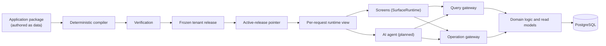

# North Star ERP

**An inventory-first ERP that a business can adapt without code changes, rebuilt from a clean slate.**

North Star ERP (package prefix `@north-star/*`, repository `2rain-greenfield`) is
operations software for a stock-holding business. A distributor uses it to buy stock,
receive it, know exactly what they have and what is free to sell, sell it, reserve it,
and ship it. The app is built so that three later goals stay possible:

- **An AI operations agent** that can look things up, plan, and carry out the same work
  a person does, using the same rules and permissions.
- **Safe customization.** An authorized user can change fields, screens, forms and
  rules without anyone editing source code. Every change can be previewed, approved,
  switched on, and rolled back.
- **Room to grow** into new modules (CRM, work orders, connectors, more of the ERP)
  without rewriting the core.

> **Status, 2026-10-22.** The purchase, receive, sell and ship loop works on `main`.
> Since mid-September the work has been a **parity push**: bringing the app up to the
> feature set of PaneFlow, a reference distributor system, through a chain of draft pull
> requests that are combined on one integration branch. None of that work has been merged
> to `main` yet. The AI agent and the customization engine are **not built yet**.
> [Where things stand](#where-things-stand) has the details.

---

## Contents

- [Why this repository exists](#why-this-repository-exists)
- [What the product does](#what-the-product-does)
- [How it works](#how-it-works)
- [The rules the code never breaks](#the-rules-the-code-never-breaks)
- [Repository map](#repository-map)
- [Roadmap: stages G0–G8 and N1–N7](#roadmap-stages-g0g8-and-n1n7)
- [Where things stand](#where-things-stand)
- [How the work gets done](#how-the-work-gets-done)
- [Running it locally](#running-it-locally)
- [Testing and CI](#testing-and-ci)
- [Where to read more](#where-to-read-more)
- [Glossary](#glossary)

---

## Why this repository exists

An earlier version of this ERP lives at `/home/rvham/2rain_erp`. It had no live users,
no production data that had to stay authoritative, and no outside integrations. So
instead of migrating it piece by piece, the program decided to **build a new product
in a clean repository** and treat the old one as a quarry: designs, tests and lessons
can be reused, but only through a deliberate review (the
[`salvage-admission`](.agents/skills/salvage-admission/SKILL.md) skill). Nothing runs
from the old code.

The main thing the restart changes is **where the definition of the application comes
from.** The old app kept its structure in static metadata with customizations layered
on top. Here there is a single application definition that is compiled into frozen
versions. The full reasoning is in section 0 of the
[program plan](docs/greenfield-north-star-erp-platform-plan.md).

## What the product does

The launch promise, in the plan's own words:

> A business can purchase stock, receive it, know what it has and what is available,
> sell and reserve it, ship it, and ask an AI agent to perform and explain those
> operations. Authorized users can safely adapt fields, views, forms, validations, and
> selected rules without source changes.

The core loop:

```text
Supplier ─► Purchase order ─► Goods receipt ─► stock goes up
                                                    │
                     On hand / Reserved / Available (always computed, never typed in)
                                                    │
Customer ─► Sales order ─► Reservation ─► Shipment ─► stock goes down
```

**An example.** A window distributor orders 40 units from a supplier. When the truck
arrives, someone records a goods receipt for 38, because two were damaged. The app
posts a movement of +38 into the receiving location. "On hand" goes up by 38 because
it is the **sum of every posted movement**, not a number someone edited. The purchase
order now shows 2 still to arrive. If the receipt turns out to be wrong, nobody edits
or deletes it. A correction is posted, and both entries stay in the history.

**Deliberately left out of launch** (planned later, not rejected): the general ledger,
tax and payroll, multi-currency, lot and serial tracking, manufacturing, a connector
marketplace, arbitrary code or SQL in customizations, and unattended high-risk
automation. Some data those features will need, such as unit cost on receipt lines and
the stock-dimension set, is still captured from day one, because it cannot be
recovered later. See plan §2.3.

## How it works

The application, meaning its records, fields, screens, lists, forms and rules, is
**written as data**: an _application package_. Today that package is
[`apps/web/release/app.authored.json`](apps/web/release/app.authored.json), generated
from the module definitions in [`packages/domain`](packages/domain/src).



In plain terms:

1. **Compile.** The compiler checks the package and turns it into a **release**, a
   frozen and versioned build of the whole app that includes its screens, its storage
   plan, and the scenarios used to verify it. The same input always produces the same
   bytes.
2. **Activate.** A business ("tenant") runs exactly one active release at a time.
   Moving to a new release is an explicit, approved step, and it can be rolled back.
3. **Pin.** Every request remembers which release it used, so a screen, a report and an
   agent answer cannot each describe a different version of the app.
4. **Go through the gateways.** Screens, and later the AI agent, never touch tables
   directly. Reads go through the _Semantic Query Gateway_ and changes go through the
   _Semantic Operation Gateway_. Both check the user's current permissions on every
   call.
5. **Post stock through one kernel.** Anything that changes stock (receipts, shipments,
   adjustments, transfers, counts, returns) goes through the **inventory posting
   kernel**, which writes append-only movements exactly once. Its guarantees are
   written down in
   [`docs/architecture/posting-kernel-guarantees.md`](docs/architecture/posting-kernel-guarantees.md).

Customization will reuse this exact path. A tenant's change becomes a new package, then
a new release, then a preview, an approval and an activation. That is why so much care
goes into the compiler and the release machinery now.

## The rules the code never breaks

These come from plan §3 and the accepted ADRs in [`docs/decisions/`](docs/decisions):

- **Stock is derived, never stored as an editable number.** On hand, reserved and
  available are computed from posted movements and reservations
  ([ADR-0007](docs/decisions/ADR-0007-append-only-inventory-posting-truth.md),
  [ADR-0057](docs/decisions/ADR-0057-posted-stock-is-a-rebuildable-ledger-sum.md)).
- **No hard deletes of business data, anywhere.** Posted facts are corrected or reversed.
- **Named operations, not generic edits.** "Receive", "Reserve" and "Ship" are
  operations with rules. Nothing patches a status field directly.
- **One authority for the app definition**, with no second layer of overrides.
- **Permissions are checked against the present**, even when the app definition is
  pinned to an older release.
- **The AI agent will never** edit source, run shell commands, touch the database
  directly, or switch on its own customizations.
- **A modular monolith first.** One web/API process, one PostgreSQL database, one
  worker. The code is split along clear seams, but it is only split into separate
  services when there is a measured reason.
- **Every record carries a company (legal-entity) dimension from creation**, so running
  several companies later is a feature, not a schema rewrite
  ([ADR-0015](docs/decisions/ADR-0015-legal-entity-business-dimension.md)).

## Repository map

```text
apps/
  api/        dev entry point: starts PostgreSQL in Docker, migrates, seeds, serves the app
  web/        the UI runtime (server-rendered screens), component registry, design tokens,
              message catalog, the compiled releases in release/, and browser tests
  worker/     placeholder for the background worker (outbox, jobs); not built yet
packages/
  canonical-model/    the application-definition language: schemas, normalization,
                      canonical bytes, predicate and aggregate kernels, size limits
  compiler/           package -> release: projections, storage plans, verification
                      scenarios, hashing, diffs
  platform-runtime/   release records and activation, storage transitions, trust contracts
  runtime/            per-request runtime view, query and operation gateways, list behavior
  postgres-provider/  the PostgreSQL implementation: migrations, release persistence and
                      verification, the inventory posting kernel, receiving, fulfillment,
                      authorization, the composed application runtime
  domain/             first-party modules as data: party, catalog, location, inventory,
                      purchasing, sales, and the app builder
  observability/      logging, metrics, request context
  dev-tooling/        architecture and dependency-boundary checks, UI grammar
                      conformance, tenant-completeness checks
  test-contracts/     reserved; empty today
db/
  migrations/         append-only SQL migrations (0001–0028 on main)
  schema.snapshot.json
test/                 unit, compiler, integration, agent, architecture and postgres suites,
                      plus fixtures and evidence helpers
scripts/              test lock, suite runner, the expected-red gate, record and
                      review-record checks
docs/                 the plan, ADRs, architecture notes, and the execution records
.agents/skills/       the binding process skills (see below)
.github/workflows/    CI
AGENTS.md             the operating doctrine for every agent and human here
learnings.md          lessons learned, recorded with the capture-learnings skill
```

Dependency direction is enforced by tests. The compiler and the domain packages never
import UI code, a model SDK, or the database provider. The apps assemble the packages
and never become the authority for business rules (plan §4.4,
[ADR-0002](docs/decisions/ADR-0002-modular-monolith-and-dependency-direction.md)).

## Roadmap: stages G0–G8 and N1–N7

The plan delivers in gated stages. "G" stages lead to launch and "N" stages lead from
launch to the full north star.

| Stage                                    | What a user gets                                                                                                                                    | State on `main`                                                                       |
| ---------------------------------------- | --------------------------------------------------------------------------------------------------------------------------------------------------- | ------------------------------------------------------------------------------------- |
| **G0** Constitution and clean repository | Engineering foundation                                                                                                                              | ✅ complete                                                                           |
| **G1** Release kernel and app shell      | An empty signed-in shell served from a compiled release                                                                                             | ✅ complete                                                                           |
| **G2** Party, item, location             | Manage suppliers, customers, items and locations                                                                                                    | ✅ complete in substance                                                              |
| **G3** Inventory truth alpha             | Know stock; adjust, transfer and count                                                                                                              | 🟡 14 of 17 gate criteria met                                                         |
| **G4** Purchasing and receiving          | Create purchase orders and receive stock                                                                                                            | 🟡 purchase orders, receiving and scoped authorization landed (PR #1)                 |
| **G5** Sales, reservation, shipping      | Create sales orders, reserve and ship                                                                                                               | 🟡 sales orders and fulfillment landed (PRs #3, #4); the gate also needs the AI agent |
| **G6** Launch customization              | Adapt the app without code                                                                                                                          | ⬜ not started                                                                        |
| **G7** Integrated pilot                  | A release candidate                                                                                                                                 | ⬜ not started                                                                        |
| **G8** Production launch                 | Live                                                                                                                                                | ⬜ not started                                                                        |
| **N1–N7**                                | Generated modules, workflows and communication, commercial depth, CRM and work orders, integrations, more ERP domains, a controlled extension point | ⬜ after launch                                                                       |

The full stage definitions and gates are in plan §11 (G stages) and §12 (N stages).

## Where things stand

_Snapshot as of 2026-10-22. The live sources are linked at the end of this section,
and they win over this README whenever the two disagree._

### On `main` (last advanced 2026-09-11)

The office-worker loop works end to end against PostgreSQL. You can manage parties,
items and locations; post stock adjustments, transfers and counts; create purchase
orders and receive them, including partial receipts and corrections; and create sales
orders, reserve stock, ship partially, and correct or reverse shipments. Stock and
order progress are always computed. A scoped authorization check runs on every call.
This is a local-demo check, and no production-grade sign-in is claimed.

### The parity push (draft PRs, not merged)

On 2026-10-04 the owner set the goal: **reach full feature parity with PaneFlow**, a
distributor operations system used as the benchmark. Ordinary features are added as
_data_ in the application package wherever possible, not as new platform code. The
work is a chain of stacked draft pull requests, each with its own branch and
worktree. They are combined on one branch,
[`packet/INTEGRATION`](https://github.com/AnserBeg/2rain-greenfield/pull/29)
(draft PR #29, marked **do not merge**, CI green). That branch exists so CI can test
everything together. It also resets the stored release history to a single entry,
which [ADR-0066](docs/decisions/ADR-0066-pre-tenant-development-re-baselines-the-release-lineage.md)
allows because no real tenant exists yet.

**Already combined on the integration branch:**

| Area                            | What it adds                                                                                                                                           |
| ------------------------------- | ------------------------------------------------------------------------------------------------------------------------------------------------------ |
| Sales and purchasing workspaces | Order entry described entirely in metadata; shared lists at parity; priced purchase orders; receipt numbers; order lists that show progress and totals |
| Posting date guard              | No stock posting dated after the business's "today" (Critical)                                                                                         |
| Payables                        | Vendor bills, payments and credits                                                                                                                     |
| Inventory                       | Stock on the item page; adjustments, transfers and opening stock entered as documents                                                                  |
| Valuation                       | Derived inventory value (moving average, ADR-0067), shipment cost, landed cost                                                                         |
| Approvals                       | Purchase-order approval, placing orders, staged amendments                                                                                             |
| Replenishment                   | Reorder points, stock by item, a buying worklist                                                                                                       |
| Locations and warehouse         | Location status and types, usable stock, warehouses, a floor-staff view, period locks                                                                  |
| Catalog extras                  | Item aliases, stocked or non-stocked items, merging duplicates, a company reorder rule                                                                 |
| Sales extras                    | Credit limits and holds, price lists, counter sales                                                                                                    |
| Supply warnings                 | Reserved and blocked-by-supply views, shortage marks                                                                                                   |
| Size limits                     | Larger caps for the app package (4 MiB, ADR-0070) and for screen composition, by owner ruling                                                          |

**Open against the integration branch** (CI green, waiting to be folded in):
COMPANY-BOUND-WRITES (#32: ordinary edits, archives and restores are tied to the
company you are working in), RECEIVING-EXTRAS (#33: received-on date, partial receipt
correction), and REPORTS-HOME (#34: receivables aging, customer statements, a home
view).

**Still in review or being built:** SALES-PARITY's latest review round (#7), UNITS
(#17), SPECIAL-ORDER and DROP-SHIP (#28, #19), STOCK-COUNTS (#23, Critical), RETURNS
(#15, Critical), RETURNABLE-ASSETS (#27: deposits on pallets, kegs and crates), and
LOCATIONS-2 (#35).

**Queued after those:** a short run of Critical correctness packets (verifying units and
locations, inventory approvals, posting-kernel guards, then lot tracking), and showing
dates and times in the business's time zone instead of UTC.

**Out of scope for this push:** work orders and labour (plan stage N4) and real
multi-user sign-in. **Not built yet:** the AI operations agent and the customization
engine, which are the platform's main payoff.

**Not authorized:** merging any of this to `main`, or deploying. The owner decides what
merges and in what form.

### Live sources

- [`docs/execution/current-plan.md`](docs/execution/current-plan.md): the active queue and operating model
- [`docs/execution/ledger.md`](docs/execution/ledger.md): what every accepted packet did
- [Open pull requests](https://github.com/AnserBeg/2rain-greenfield/pulls), and on the integration branch,
  [`docs/execution/packets/INTEGRATION.md`](https://github.com/AnserBeg/2rain-greenfield/blob/packet/INTEGRATION/docs/execution/packets/INTEGRATION.md)

## How the work gets done

This repository is built mostly by AI coding agents under human direction. The process
is written down because it is what keeps that safe.

- **The owner** picks the work, tests each step by hand, makes the rulings, and merges.
- **The orchestrator** (Claude) writes the charters, adjudicates findings by reading the
  code, and keeps the records. It does not write product code.
- **Writers and reviewers** (Codex and Claude sessions) build and review one _packet_
  each.

**A packet** is one bounded piece of work with a written charter. The charter says what
the packet changes, which files it owns, which checks prove it, and ends with a **"Test
it yourself"** section the owner can click through in a few minutes. Each packet lives
on its own `packet/<NAME>` branch, usually in its own sibling worktree such as
`../2rain-greenfield-returns`. The binding mechanics are in
[`mission-cadence`](.agents/skills/mission-cadence/SKILL.md).

**Acceptance** means CI is green at the exact pushed commit. Integration is a
`git merge --no-ff` of the packet into `main`
([`git-workflow`](.agents/skills/git-workflow/SKILL.md)).

**Review is proportional to risk.** Every packet has a tier: _Mechanical_, _Behavioral_
or _Critical_. Critical work, meaning the posting kernel, storage transitions, release
verification and authorization, gets one independent review by a fresh reviewer that
looks for production defects only. Everything else ships on tests plus the owner's
click-through ([`review-tiers`](.agents/skills/review-tiers/SKILL.md)).

**A test must be shown to fail.** Every gate comes with _negative controls_. Each
control is a deliberate break of the code, and the gate has to catch it (go "red").
That proves the test checks something real. `scripts/check-expected-red.sh` runs them
([ADR-0058](docs/decisions/ADR-0058-an-expected-red-is-identified-by-what-it-kills.md)).

**Decisions are recorded.** Architectural choices become ADRs in
[`docs/decisions/`](docs/decisions). Outcomes go in the ledger. Lessons go in
[`learnings.md`](learnings.md). Whole-app _program reviews_ at stage boundaries ask
whether the goal and the approach are still right
([`program-review`](.agents/skills/program-review/SKILL.md),
[`docs/execution/program-reviews/`](docs/execution/program-reviews)).

The order of authority, highest first: **the plan, then accepted ADRs, then skills,
then [`AGENTS.md`](AGENTS.md)**.

## Running it locally

**Prerequisites:** Ubuntu or WSL, Node `22.22.2` (see `.node-version`), pnpm `11.9.0`
through Corepack, and a running Docker engine for PostgreSQL.

```bash
corepack enable
```

```bash
corepack pnpm install --frozen-lockfile
```

**Start the app.** This starts a pinned PostgreSQL container on port `55432`, runs the
migrations, seeds a demo distributor, and serves the app at <http://127.0.0.1:4174>:

```bash
corepack pnpm dev
```

To use your own database instead, set `DATABASE_URL`. To change the port, set `PORT`.
To reset or stop the dev database:

```bash
corepack pnpm --filter @north-star/api dev:reset
```

```bash
corepack pnpm --filter @north-star/api dev:stop
```

**No Docker?** The UI shell fixture runs without a database at <http://127.0.0.1:4173>:

```bash
corepack pnpm --filter @north-star/web serve:shell-fixture
```

**After changing the application package,** rebuild the compiled release and check
that it is current:

```bash
corepack pnpm --filter @north-star/web build:app-release
```

```bash
corepack pnpm check:app-release
```

## Testing and CI

The fast checks need no database:

```bash
corepack pnpm lint
```

```bash
corepack pnpm typecheck
```

```bash
corepack pnpm test:unit
```

```bash
corepack pnpm test:compiler
```

The heavier suites need Docker and take a repository-wide test lock, so run them one at
a time: `test:integration`, `test:architecture`, `test:postgres`, `test:browser`
(Playwright), and `test:performance`. `corepack pnpm test` runs the whole matrix in
order.

**CI is the acceptance gate.**
[`.github/workflows/ci.yml`](.github/workflows/ci.yml) runs seven jobs on `main`:
quality and build, the compiler performance budget, PostgreSQL schema and isolation,
browser tests, dependency and secret scans, observability evidence, and _executed-file
reachability_. Reachability proves that every test file actually ran in CI. The
integration branch splits these into fourteen jobs so that each stays within its time
limit.

Run one container-backed suite at a time on a laptop. Running several in parallel has
stopped Docker before.

## Where to read more

| If you want…                                 | Read                                                                                                        |
| -------------------------------------------- | ----------------------------------------------------------------------------------------------------------- |
| The vision, the architecture and every stage | [`docs/greenfield-north-star-erp-platform-plan.md`](docs/greenfield-north-star-erp-platform-plan.md)        |
| The rules for working here                   | [`AGENTS.md`](AGENTS.md), then [`.agents/skills/`](.agents/skills)                                          |
| What is next, and why                        | [`docs/execution/current-plan.md`](docs/execution/current-plan.md)                                          |
| What has been done                           | [`docs/execution/ledger.md`](docs/execution/ledger.md)                                                      |
| Why a design is the way it is                | [`docs/decisions/`](docs/decisions) (66 ADRs on `main`)                                                     |
| How stock posting is kept correct            | [`docs/architecture/posting-kernel-guarantees.md`](docs/architecture/posting-kernel-guarantees.md)          |
| Who is allowed to decide what at runtime     | [`docs/architecture/runtime-authority-map.md`](docs/architecture/runtime-authority-map.md)                  |
| The application-definition language          | [`docs/architecture/canonical-language-v0.md`](docs/architecture/canonical-language-v0.md)                  |
| Starting a new orchestrator session          | [`docs/execution/orchestrator-handoff.md`](docs/execution/orchestrator-handoff.md) (read its banners first) |
| Lessons learned the hard way                 | [`learnings.md`](learnings.md)                                                                              |

## Glossary

| Term                                | Meaning                                                                                                             |
| ----------------------------------- | ------------------------------------------------------------------------------------------------------------------- |
| **Application package**             | The whole app described as data: records, fields, screens, lists, forms, rules                                      |
| **Release** (tenant release)        | A frozen, versioned compile of a package. A tenant runs exactly one active release                                  |
| **Tenant**                          | One business using the system. No real tenant exists yet ("pre-tenant mode")                                        |
| **Re-baseline**                     | Resetting the stored release history to a single entry. This is allowed only while no real tenant exists (ADR-0066) |
| **Gateways**                        | The only way in for reads (query gateway) and changes (operation gateway)                                           |
| **Posting kernel**                  | The one code path that writes stock movements, exactly once and append-only                                         |
| **Packet**                          | One bounded, chartered piece of work, ending in a "Test it yourself" checkpoint                                     |
| **Lane**                            | A packet in progress on its own branch and worktree                                                                 |
| **Tier**                            | How risky a packet is: Mechanical, Behavioral or Critical. Sets how hard it is reviewed                             |
| **Negative control / expected red** | A deliberate break that a test must catch, which proves the test is real                                            |
| **ADR**                             | Architecture Decision Record, in `docs/decisions/`                                                                  |
| **Parity / PaneFlow**               | PaneFlow is the reference distributor system. Parity means matching its features                                    |
| **The quarry**                      | The previous repository, `2rain_erp`. It can be read for reuse but is never a dependency                            |
